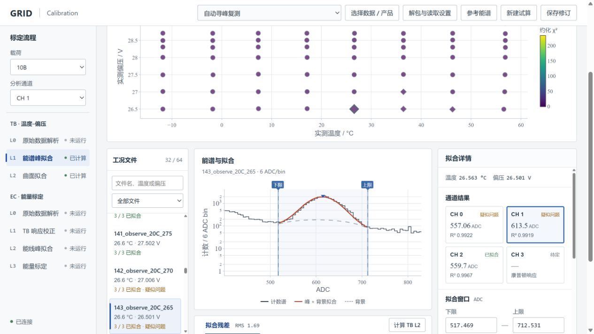
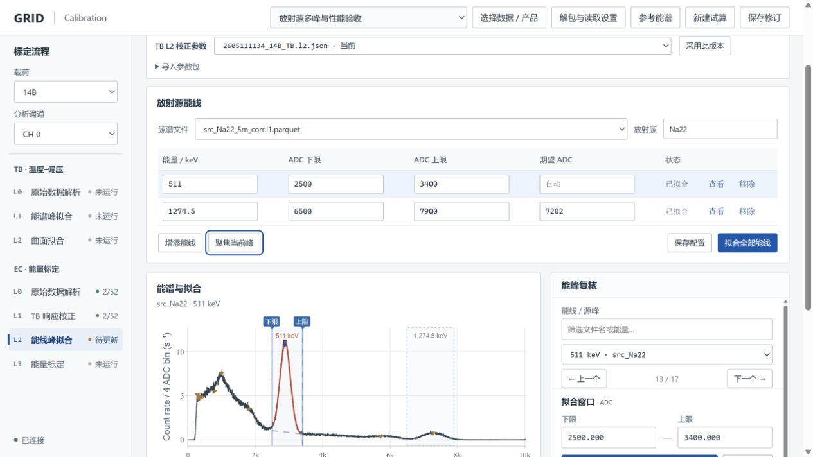
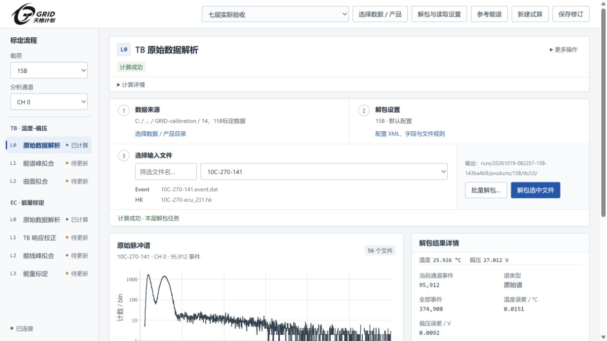
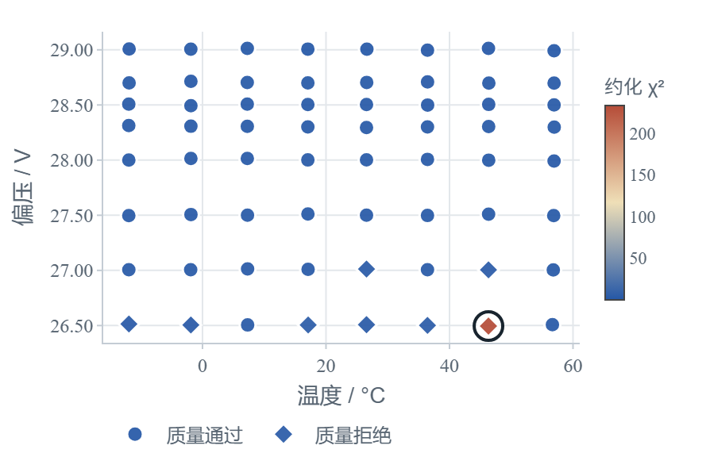
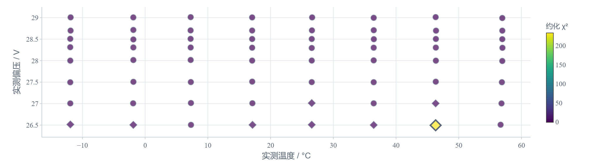
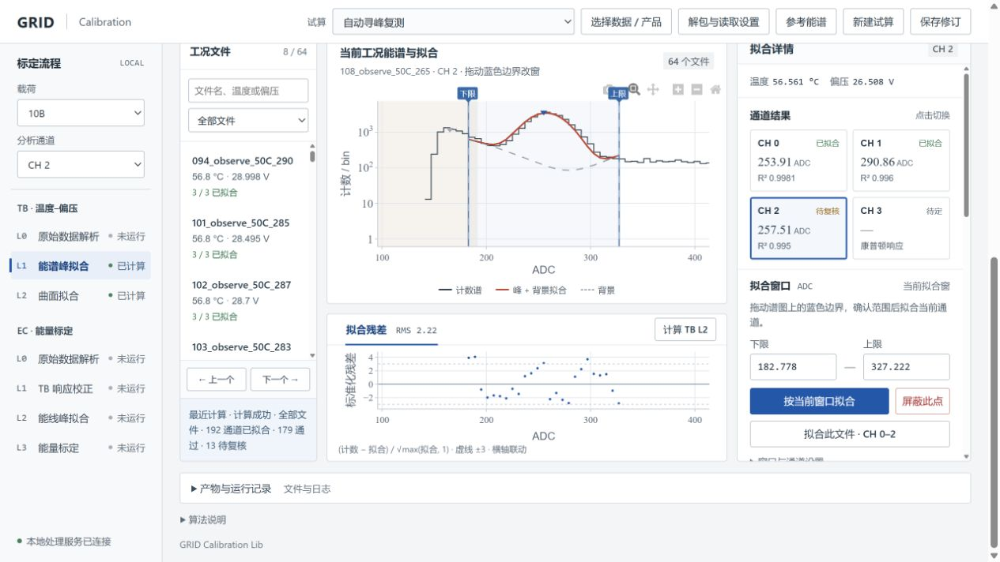
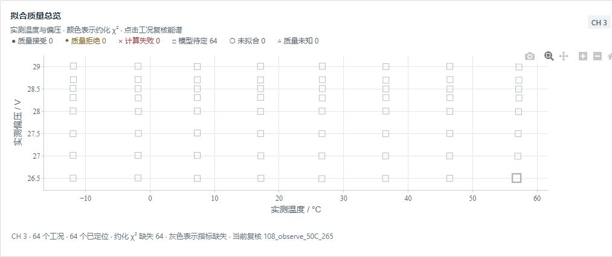

# 检查点 2：初始进展

李涛｜2024011089  
项目：天格探测器标定流程可视化与交互拟合平台  
2026 年 10 月 25 日

## 1. 从流程总览到实际处理

检查点 1 完成了一个标定流程总览，可以查看已有产物、切换载荷和预览图片。这一阶段，我开始把实际计算和人工复核接进页面。原有的标定库已经能完成温度—偏压标定（TB）和能量标定（EC），使用时比较麻烦的是检查和修改：看到一个异常点，还要找对应文件、打开能谱、修改拟合窗，再运行脚本更新结果。

现在，工作台可以按载荷、工况和通道查看结果，从 TB 曲面或质量地图中的点打开对应能谱，同时查看拟合曲线、参数和残差。如果窗口不合适，可以在图上拖动边界，或输入准确的 ADC 范围，只重拟合当前通道；如果暂时不采用这个点，可以将它屏蔽，再更新曲面。所选文件、窗口、配置和计算结果会保存在试算中，重开后能够接着处理。



图 1：10B 的 TB 谱复核界面。左侧选择工况，中间检查能谱，右侧调整窗口和切换通道。

EC 部分也沿着这个思路改进。Na22、Co60 的一张源谱中有多条能线，各峰、各通道需要使用不同的窗口。现在可以在页面中增添或移除能线，分别设置窗口和中心锚，拟合当前峰或当前通道的全部能线。这样复核某个峰时，就能直接修改它的配置，保留其他通道的结果。



图 2：Na22 的两条能线及各自窗口。界面支持选峰查看、修改窗口、拟合和保存。

这些交互已经接入原库的 TB L0—L2、EC L0—L3 处理程序。每一步可以查看输入、执行结果和输出文件，新计算写入独立的 `runs/` 目录。不同载荷的 XML、字段换算和文件配对规则也可以在工作台配置，并保存为读取预设；EC 使用哪一版 TB 参数，则单独选择和保存。

## 2. 实际使用中发现和处理的问题

我在本地启动服务后，先后检查了主工作台和两组实验界面。早期 L1 处理较慢，文件切换不顺，拟合结果也不够直观。我据此要求调整文件列表、通道切换和谱图布局，并继续优化读取速度。后来为能谱和文件信息增加了缓存，减少了切换工况、能线时的重复读取。

看原谱时，我发现了更直接影响标定的问题：15B 的谱尾拖出一段奇怪的噪声，14B 的 Cs137 和 Co60 则显示 CRC 全部失败。我怀疑是读取配置加载有误，要求对照原始包检查。复查发现，这些旧产物采用了每包 40 个事件、12 字节步长的设置，而对应载荷应使用 38 个事件、14 字节步长。修正配置后，重新生成了这些试算中的产物。



图 3：15B `10C-270-141 / CH0` 重新解包后的原谱。

同一张 15B 谱中，1200 ADC 以上事件的占比从旧解析的 56.9% 降到了 1.23%；复查中 CRC 有效的尾部事件继续保留。15B 共 56 份 TB L0 文件完成重建，CRC 和格式检查通过。14B 重新读取的 Cs137、Co60 和本底分别有 490,390、2,196,096 和 388,018 条事件，CRC 失败数均为 0。工作台也增加了重新解包和重建源谱的入口，遇到这类旧产物时可以直接继续处理。

多峰编辑的运行记录中，Na22 CH0 的 511 keV 和 1274.5 keV 两个峰分别拟合到 2885.639 ± 0.690 ADC、7293.812 ± 4.489 ADC；局部重算保留了其他通道的结果和待拟合状态。窗口及中心锚保存后，重开试算可以恢复。这些结果和操作截图保存在[验收附件](attachments/README.md)中。

自动回归检查的最新记录为 504 项 Python 测试、109 项前端测试通过，完整日志同样保存在附件中。

## 3. 用会话 fork 比较两种提示方式

复核单张谱的入口做起来后，还需要解决如何从几十个工况中找到值得检查的谱。因此，这次选“TB L1 拟合质量地图”作为 fork 实验任务：把不同温度、偏压下的拟合结果放在一张图中，点击某个点，就能回到已有的谱复核界面。

我先建立“CP2-共同起点”会话，让模型阅读已有代码和项目说明，再从这里 fork 出 A、B。两组都从代码提交 `b90b3aa` 开始，使用同一个 10B 试算的 64 份 L1 结果，文件哈希一致；模型和设置也相同，均为 `gpt-6.1-sol`、`ultra`。A、B 分别放在独立的 Git worktree 中，使用各自的输出目录和 8766、8767 端口。

| 方案 | 提示方式 |
| --- | --- |
| A | 说明用途：按通道查看不同工况的拟合质量，找到需要复核的谱，点击后打开能谱、窗口和残差。具体怎么呈现由模型决定。 |
| B | 在同一目标上进一步指定：使用实测温度和偏压，颜色表示约化 χ²，点形区分状态，悬停显示文件和诊断；单独处理模型待定、失败及指标缺失的情况。 |

两组都要求复用已有结果和质量判据，完成可操作界面及验证。[AI 记录](ai-records/README.md)保留了分叉前的共同上下文、两组完整会话和[提示词原文](ai-records/fork-prompts.md)。



图 4：方案 A 的 CH0 质量地图。



图 5：方案 B 的同通道质量地图。两图使用相同输入，均选中 `120_observe_40C_265`；64 个工况中，56 个通过当时的质量判据，8 个被标为拒绝。

A、B 都能切换通道，并从地图打开对应能谱。浏览器验证中，点击 CH2 唯一的拒绝点后，两边都打开了 `108_observe_50C_265 / CH2`，峰位均为 257.508 ± 0.344 ADC。这张谱的 R² 为 0.99501，约化 χ² 为 6.296：拟合曲线看起来贴合主峰，残差仍有明显偏离。质量地图先把这类谱找出来，下钻页面再帮助判断问题出在哪里。



图 6：方案 B 点击质量点后打开的能谱、窗口和残差。

差别主要出现在 CH3。这个塑料闪烁体通道的 64 个工况都还没有确定合适的拟合模型。A 没有在地图中显示这些点，只提示缺少有效温偏坐标，仍可从明细打开能谱；B 则保留全部 64 个工况，用灰色空心方点表示，并标明约化 χ² 缺失。B 对这类情况交代得更清楚，所以我选择它继续开发。B 的提交已纳入主开发分支，A 仍保留供对照。



图 7：方案 B 中的 CH3，64 个工况均显示为模型待定。

这组实验也让我继续调整了质量提示的用法。实验时，CH0—2 共 192 组结果中有 13 组被判为拒绝；我随后要求先提示疑似问题，让人查看原谱后决定是否屏蔽。因此，当前主版本会保留这些点的提示，192 组数值有效的参数都能进入 TB 曲面拟合。实验截图保留的是修改前的状态。

## 4. 这次使用 AI 编程的体会

“避免不必要的次要标签和描述”是这次界面修改中很管用的一句话。早期页面喜欢在按钮旁解释按钮、在状态旁重复状态，还加上常驻的操作说明。信息越堆越多，真正要看的谱和参数反而被挤开了。删掉这些文字后，文件列表、选中高亮和控件位置已经能表达大部分关系。写作时也有类似的问题：反复解释边界、预先回应可能的质疑，会打断正文。该交代的事实要交代清楚，段落则应该把理由和结果顺着讲下去。

A、B 的效果差异没有我预想的大。A 只把目标和使用方式讲清楚，模型也完成了地图和联动；B 多写了呈现细节，主要改善了状态和缺失指标的处理。对这个已有代码基础的项目，我觉得更值得花时间的是想清楚下一步要解决什么问题、做出来以后怎么用。目标明确后，常规实现往往可以交给模型补齐；把布局和实现路径规定得太细，有时也会限制它的发挥。

一开始我还担心两个 fork 都在本地项目上动手，会互相覆盖。实际做过以后才把两件事分清：fork 继承的是对话上下文，Git worktree 提供的是独立代码目录。两边再使用不同的试算目录和端口，就能同时开发和运行，比较之后再选择一边合入。以后遇到某个功能有两种做法，或者想单独试一个算法，这种方式会很方便。

## 5. 代码、环境与运行

项目继续使用公开仓库 [GRID_Calibration_Lib](https://github.com/Lee-Eee-Eee/GRID_Calibration_Lib)，下面三个分支均已推送。完整提交编号也记录在 `submission.json` 中。

| 代码 | 分支 | 提交 |
| --- | --- | --- |
| 当前项目 | `feat/calibration-workbench` | [ced4e8c](https://github.com/Lee-Eee-Eee/GRID_Calibration_Lib/commit/ced4e8c2bb4b3eb040fab0238a0161b7011245cb) |
| 实验 A | `experiment/cp2-quality-a` | [3f26210](https://github.com/Lee-Eee-Eee/GRID_Calibration_Lib/commit/3f2621085ef9b582c7a82b49114141e942959115) |
| 实验 B | `experiment/cp2-quality-b` | [8e66e62](https://github.com/Lee-Eee-Eee/GRID_Calibration_Lib/commit/8e66e62afc6e1d0ca20c6782d46f80e040e279f0) |

提交包的 `project/` 保留了 `.git/` 和版本历史。报告、会话及附件同时放在仓库的 [`course/checkpoint2`](https://github.com/Lee-Eee-Eee/GRID_Calibration_Lib/tree/course/checkpoint2/course/checkpoint2) 分支。

本机使用 Windows、Python 3.11.15、Node.js 24.11.1。Python 端使用 NumPy、pandas、PyArrow、SciPy、lmfit 等库，页面使用 HTML/CSS/JavaScript 和本地 Plotly。解压后，从提交目录运行：

```powershell
cd project
python -m venv .venv
.venv/Scripts/python.exe -m pip install ".[workbench,dev]"
.venv/Scripts/grid-workbench.exe --workspace ../workspace --port 8765
```

打开 `http://127.0.0.1:8765/`，选择实验数据或已有产品目录、载荷预设，再创建试算。新结果保存在 `workspace/runs/`。完整解包使用对应的事件和 HK 文件；随包还提供了[真实 L1 结果与计数直方图小样例](attachments/samples/README.md)，可直接读取查看。

自动检查命令如下，在 `project/` 中运行：

```powershell
.venv/Scripts/python.exe -m pytest tests -q
node --test tests/frontend/*.test.cjs
```

## 6. 还需要继续处理的问题

接下来首先要继续检查自动寻峰在困难谱上的表现。低偏压下目标峰容易靠近暗噪声，Co60 的相邻峰又存在尾部重叠；目前的单峰模型和窗口选择还需要逐谱复核，并比较联合模型及窗口变化对峰位的影响。10B/11B 的塑料 CH3 主要呈康普顿响应，模型也还没有定下来。

流程上，EC L3 的拟合方向和分段系数约定还要与 wiki 统一，部分能段的分辨率点数也不足。计算任务取消、长任务独立运行等操作还需要补上，避免处理一批数据时只能等待任务结束。

## 7. 补充：原项目做什么，为什么要改进

检查点 1 对原项目介绍得比较简略，这里结合标定流程图补充背景。

这个项目来自我正在使用和维护的天格探测器标定库 `calibration_lib`，最初处理的是 14B、15B 的地面标定数据。探测器记录的信号幅度以 ADC 道址表示，同一能量的信号会随着温度和偏压变化而移动。因此，从原始数据得到能量刻度之前，需要先知道增益怎样随工况变化。


图 8：原项目的 TB 与 EC 标定流程。TB L2 生成的增益参数用于 EC 的温偏校正。

图中上半部分是 TB 标定：固定入射能量，在不同温度、偏压下测量同一能峰的位置，先整理数据、逐谱拟合，再得到增益曲面。下半部分是 EC 标定：利用这组 TB 参数，把不同工况的信号校正到统一参考条件，然后拟合已知 X 射线或放射源能线，建立 ADC 与能量的对应关系，并计算能量分辨率。两条流程前后相接，一处峰位或输入配置出了问题，就可能影响后面的校正和标定。

前期的 `calibration_lib` 已实现这七层处理，提供了命令行、拟合窗口工具和分层输出；`calibration_process` 用来对照已有算法，`cali_format` 及其 wiki 规定输出文件的格式。本课程继续在这个库上改进。

原来的痛点最容易在复核一个异常点时体现出来。例如，TB 曲面上某个点明显偏离，需要先确定它属于哪个工况、哪个通道，再找原谱，看是选错了峰、窗口不合适，还是数据本身有问题。改过窗口后，还要重新生成这一点的结果，再更新曲面，比较参数的变化。这些动作分散在脚本、配置和图片之间，一批数据中多遇到几个问题，就会花很多时间来回查找。EC 的一张源谱又可能有多个峰，各通道窗口不同，人工管理更加零散。

所以，我希望把复核过程真正做顺：从曲面或质量地图点进原谱，看到该点使用的窗口、拟合曲线和残差；需要时直接改窗，或暂时屏蔽，再重算、比较。处理过程中使用的读取配置、TB 参数版本和人工修改一起保存，各层结果按现有 wiki 输出。下次打开这份试算时，能知道上次改到了哪里，也能找到最终参数对应的原谱。

算法方面，希望减少明显选错峰和反复手动调窗的情况。后续会用正常谱、低偏压困难谱和多峰源谱分别检查候选峰与窗口，记录选峰是否正确、哪些情况仍会失败、需要多少人工调整，并比较改窗后峰位的稳定性。候选峰、所用窗口和失败原因应能在界面中逐点查看。这样，自动处理后留下哪些困难谱、哪些窗口需要调整，就有了具体的复核入口。
