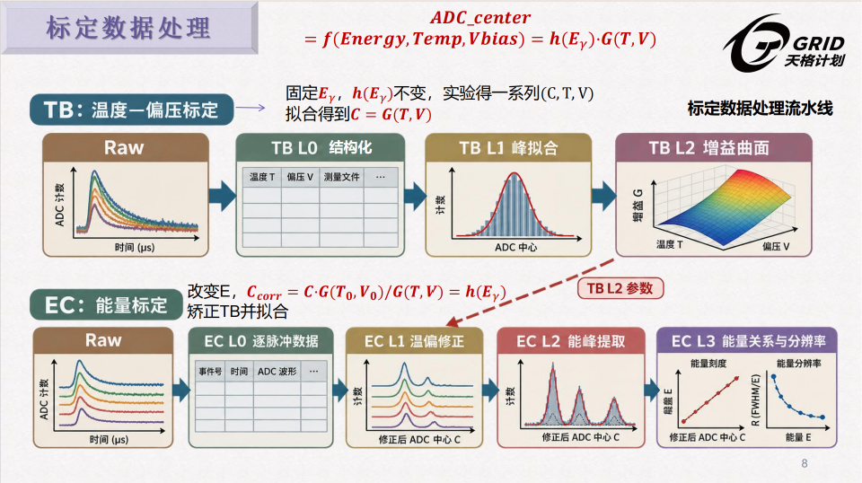

# 处理与数据指南

[返回项目首页](../README.md) · [工作台操作](../workbench/README.md)

## TB 与 EC



TB 在固定入射能量下测量温度、偏压对谱峰位置的影响；EC 采用 TB 参数进行温偏校正，再利用已知能线建立能量刻度。

| 层级 | 处理 | 主要产物 |
| --- | --- | --- |
| TB L0 | 解包事件与 HK，读取幅度和实测温偏，检查 CRC。 | Parquet 与元数据。 |
| TB L1 | 按工况和通道选择谱峰、拟合窗口与单背景模型。 | 峰位、误差、诊断及拟合图。 |
| TB L2 | 将多个工况的峰位拟合为温偏增益曲面。 | 每通道曲面参数及残差图。 |
| EC L0 | 读取 X 射线、放射源及本底数据。 | 事件幅度、温偏与时间信息。 |
| EC L1 | 采用指定 TB 参数校正信号幅度。 | 校正后的 Parquet 与 TB 版本记录。 |
| EC L2 | 对已知能线拟合峰位，多峰源使用独立窗口。 | 各能线、各通道的拟合结果。 |
| EC L3 | 拟合能量关系和分辨率。 | 带时间戳的 EC 参数及图表。 |

TB L1 和 EC L2 共用候选寻峰与质量诊断，模型采用单高斯峰加单一背景：无背景、线性、指数或二次背景。计数误差、模型选择和提示规则见 [寻峰说明](peak_finding.md)。

## 工作区与输出

工作区是数据、已有产品和试算的组织位置，可以放在代码仓库之外。启动前创建工作区目录：

```powershell
New-Item -ItemType Directory -Force ../grid-workspace | Out-Null
uv run --extra workbench grid-workbench --workspace ../grid-workspace --port 8765
```

在界面选择已有数据和产品目录，创建独立试算。试算结果与运行记录放在 `runs/<run_id>/`；原始输入与历史产品作为读取来源。

```text
grid-workspace/
└── runs/
    ├── _presets/          # 载荷读取预设与版本
    ├── _sources/          # 已索引的数据目录
    └── <run_id>/
        ├── products/      # 本次试算的分层结果
        ├── jobs/          # 每次任务的输入、配置与输出记录
        └── ...            # 试算状态与人工修订
```

产品按载荷和流程组织：

```text
products/<payload>/
├── tb/
│   ├── L0/                # parquet / json
│   ├── L1/                # json / figures
│   └── L2/                # json / figures
└── ec/
    ├── L0/                # parquet / json
    ├── L1/                # parquet / json
    ├── L2/                # json / figures
    └── L3/                # json / figures
```

例如，TB L1 峰拟合记录使用 `{stem}_fit_results.l1.json`，TB L2 与 EC L3 参数分别使用带时间戳的 `*_TB.l2.json`、`*_EC.l3.json`。每层的 manifest 记录批处理结果、输入输出和单项错误。工作台还会固定读取配置及 EC 所用 TB 参数，保存窗口与屏蔽状态。

## 命令行运行

`grid-calib` 使用库内置的 14B / 15B 配置，接受 `TB_L0`、`TB_L1`、`TB_L2`、`EC_L0`、`EC_L1`、`EC_L2`、`EC_L3`。原始数据路径由 [载荷配置](../config/payload_config.py) 指定；命名、XML 或字段有差异时，使用工作台编辑读取预设。

从源码可编辑安装时，默认 14B / 15B 原始目录相对于仓库上一级：

```text
14、15B标定数据/
├── 02/                    # 14B
│   ├── Temp_Vbias/
│   ├── X_new/
│   └── source/
└── 03/                    # 15B，具体子目录见载荷配置
```

在仓库根目录运行：

```bash
uv run grid-calib 14B TB_L0 --products ../products
uv run grid-calib 14B TB_L1 --products ../products
uv run grid-calib 14B TB_L2 --products ../products
```

修改某个工况的窗口后，可以只重跑对应 TB L1，再更新曲面：

```bash
uv run grid-calib 15B TB_L1 --products ../products --only m20C-287-106,0C-285-137
uv run grid-calib 15B TB_L2 --products ../products
```

`--only` 接原始 stem，只用于 TB L1。EC L1 的 CLI 会选择当前输出目录中最新的 TB L2 参数；需要明确指定另一次标定的 TB 版本时，使用工作台或 Python API。

## Python API

```python
from pathlib import Path
from calibration_lib.pipeline import CalibrationPipeline

pipeline = CalibrationPipeline("14B", Path("../products"))
tb_results = pipeline.run_tb()
ec_results = pipeline.run_ec()
```

EC 也可以显式指定 TB 参数：

```python
pipeline.run_ec(tb_l2_json_path=Path("../parameters/selected_TB.l2.json"))
```

## TB 曲面模型

```text
G(T, V) = G0 · (V − k·T − V0)² · (−T² + b·T + c)
```

| 参数 | 初值 | 边界 |
| --- | ---: | --- |
| G0 | 0.012 | [1e−5, 100] |
| k | 0.0184 | [0.001, 0.05] |
| V0 | 24.11 | [23, 25] |
| b | 54.31 | [−500, 500] |
| c | 23459.83 | [1e3, 1e8] |

`k` 作为自由参数参与拟合。权重采用 L1 的 `1/center_err`，曲面结果同时输出约化 χ²、RMSE 和 MAPE。具体实现见 [TB L2 处理器](../tb/processors/L2_processor.py)。

## 只读产物总览

已有产品还可以生成独立 HTML 供浏览：

```bash
uv run python tools/flow_overview.py --products ../products --out ../outputs/calibration_flow.html --check
```

该工具扫描产品目录并检查文件链接，适合查看历史结果。需要执行计算、调整窗口或保存修订时，使用工作台。
